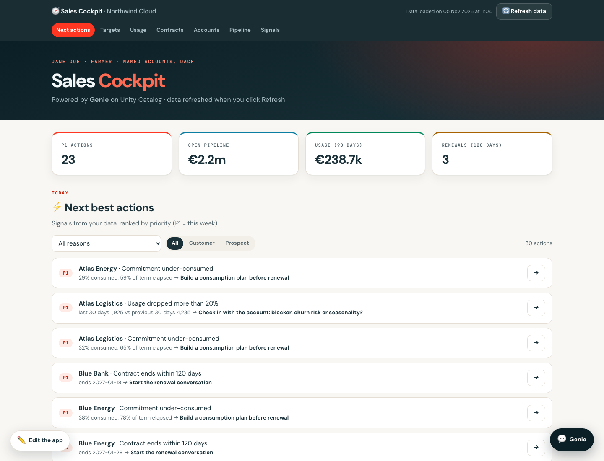
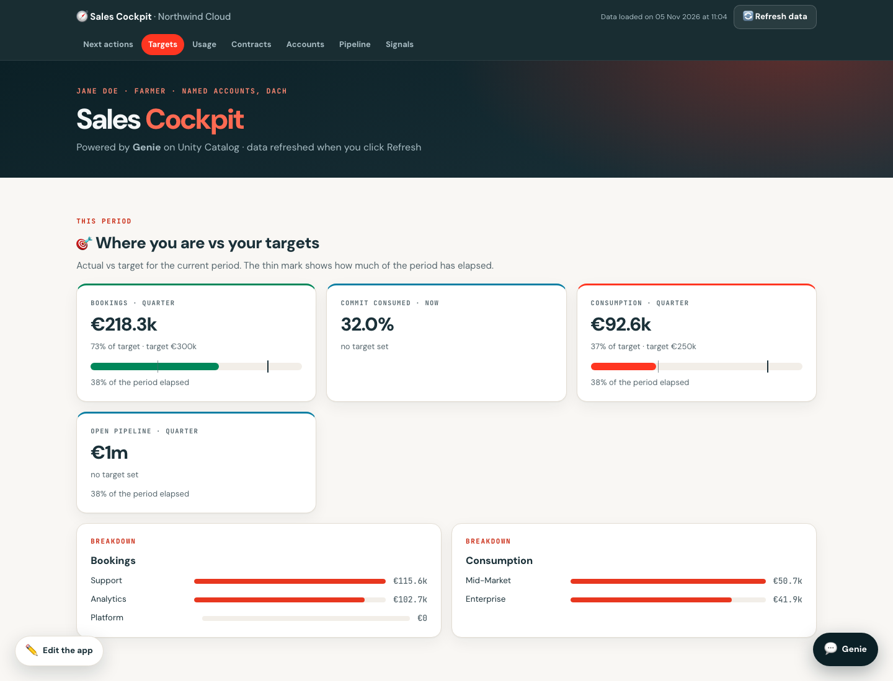
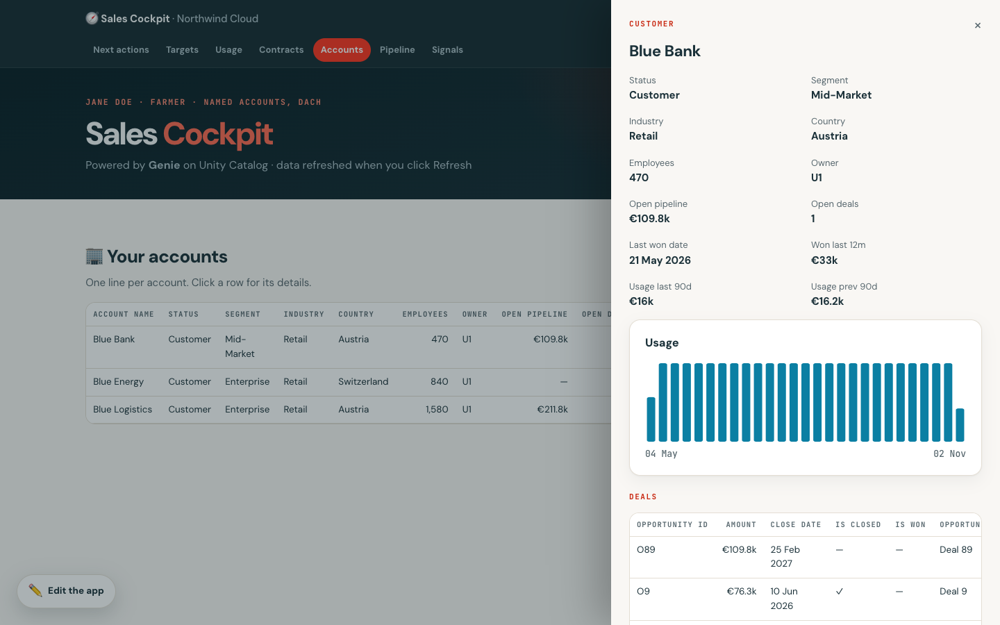
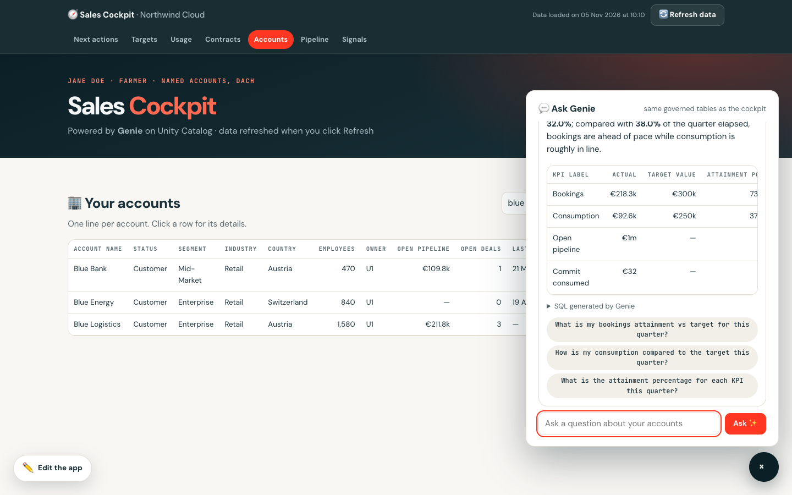
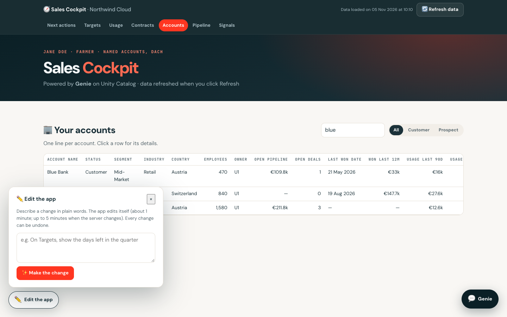
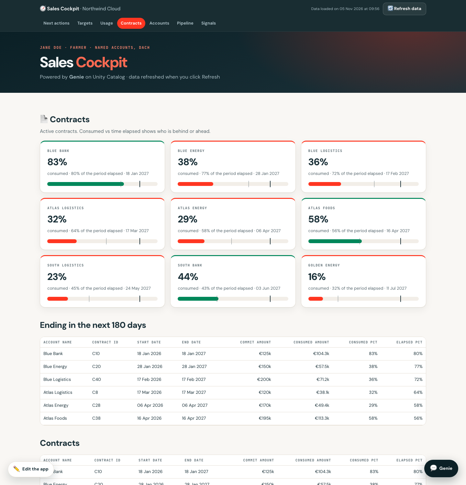
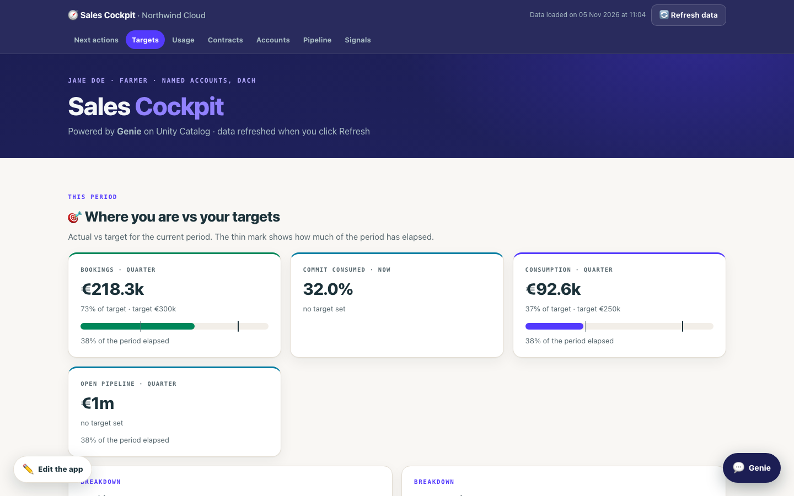

# Sales Cockpit Builder: a Genie Code skill

Build your own AI sales cockpit on your company's Databricks data: no code, just answers to a few questions.

The skill interviews you about how you sell, finds your sales data in Unity Catalog, and builds a private
**Genie space** and a **cockpit app** on your own book of business: next best actions, targets, accounts, pipeline,
usage, contracts and signals, with Genie on every page.



> Every screenshot uses made-up data ("Northwind Cloud", "Jane Doe"). Any resemblance to a real customer is a coincidence.

**Who it's for:** sales people (AEs, account managers, SDRs, sales managers) at companies that **already use
Databricks**, with their sales data already in Unity Catalog.
Not on Databricks yet? See [the last section](#your-company-isnt-on-databricks-yet).

---

## What it does

When you ask Genie Code to build your sales cockpit, it follows this skill step by step:

1. **It interviews you** in 3 short rounds: your role (hunter, farmer, hybrid, SDR, manager), your book (named
   accounts, territory), how your company sells (subscription, commitment, consumption, transactional or a mix),
   your fiscal calendar and currency, the KPIs you're measured on and how they're counted, your targets, and the tools
   you use (CRM, product usage, contracts, quotas, prospecting and intent tools, marketing, support).
2. **It finds your data.** It searches Unity Catalog for tables that look like accounts, deals, usage, contracts,
   activities, contacts, signals or targets, shows you the candidates and proposes a mapping. You confirm. It never
   guesses business meaning ("what is a customer here?"): it asks.
3. **It handles missing data honestly.** If something you need is not in Databricks, or you can't access it, it
   doesn't fake it: it tells you who to ask (the data team for ingestion, the table owner for access), drafts the
   message for you and builds everything else.
4. **It builds your book of business**: views on your accounts only, your KPIs against your targets on your fiscal
   calendar, and next best actions that fit your sales motion (deals past their close date, usage drops, commitments
   under- or over-consumed, renewals coming up, new signals on prospects…).
5. **It creates your private Genie space**, with your vocabulary, your KPI definitions and example questions, tested
   before hand-over.
6. **It builds and deploys your cockpit as a Databricks App**, in the standard colours or your company's brand
   colours (taken from your website), with an **✏️ Edit the app** button to change it in plain words.

| Targets | Account details |
|---|---|
|  |  |
| **Ask Genie (on every page)** | **Edit the app, in plain words** |
|  |  |
| **Contracts and commitments** | **Your brand colours** |
|  |  |

## Requirements

- A Databricks workspace with **Genie Code** (agent mode)
- Your sales data in **Unity Catalog**, readable by you. At least your **accounts** (from your CRM); ideally also
  deals, product usage, contracts, activities, contacts, prospecting/intent signals and targets
- A **SQL warehouse** you can use (serverless recommended)
- A catalog where you can **create a schema** (for example a personal or sandbox catalog)
- **Databricks Apps** enabled, for the cockpit app. Without it you still get your Genie space
- Optional: a **model serving endpoint** for chat (for example a pay-per-token Claude or GPT foundation model) for
  the Edit the app button. Without one, the button is hidden

If something is missing, the skill tells you what and who can help.

## Install

Genie Code loads skills from `.assistant/skills/` folders and from folders you register in its settings
([docs](https://docs.databricks.com/aws/en/genie-code/skills)).

**Option 1: Git folder (recommended, easy to update)**
1. In your workspace: **Workspace → Create → Git folder**, paste this repository's URL. It's cloned into your home
   folder, for example `/Users/you@company.com/sales-cockpit-skill`.
2. Open **Genie Code → Settings**, and in the skills section **add the folder** `/Users/you@company.com/sales-cockpit-skill`
   (the repository root: it contains the `sales-cockpit-builder/` skill folder).
3. To update later: pull the Git folder.

**Option 2: copy it into your skills folder** with the [Databricks CLI](https://docs.databricks.com/aws/en/dev-tools/cli/):
```bash
git clone <this repository URL>
databricks workspace import-dir sales-cockpit-skill/sales-cockpit-builder \
  "/Users/you@company.com/.assistant/skills/sales-cockpit-builder"
```

**Option 3: for the whole sales team.** A workspace admin copies `sales-cockpit-builder/` into
`/Workspace/.assistant/skills/`. Everyone in the workspace can then use it.

## Use it

Open Genie Code, start a **new chat** and type:

```
@sales-cockpit-builder build my sales cockpit
```

Then answer its questions. It works in a notebook it creates in `/Users/<you>/sales-cockpit/`. Plan for some back
and forth: the cleaner your data and definitions, the faster it goes.

Later, in a new chat:
- **"update my sales cockpit"**: add a KPI, a data source, a page, new targets, other colours
- **✏️ Edit the app** (in the app): change the layout or texts in plain words ("On Targets, show the days left in
  the quarter"). Every change can be undone

## What gets created

| What | Where |
|---|---|
| Your settings (interview answers, data mapping, KPIs, theme) | `/Users/<you>/sales-cockpit/cockpit_config.json` |
| Views on your book only: `accounts`, `opportunities`, `usage`, `contracts`, `activities`, `contacts`, `signals`, `leads` (the ones you have), plus `targets`, `kpi_attainment`, `account_overview`, `next_actions` | the schema you choose, e.g. `<catalog>.sales_cockpit_<you>` |
| A private Genie space "Sales cockpit — <you>" | `/Users/<you>/sales-cockpit/` |
| A Databricks App `sales-cockpit-<you>` (code in `/Users/<you>/sales-cockpit/app`) | Compute → Apps |

The views are live: the cockpit follows your source tables as they refresh. Nothing is copied except the targets
you type in.

## Privacy and permissions

- Everything runs **in your workspace, as you**, under your Unity Catalog permissions: the skill only sees what you
  can see, and only reads your source tables (it writes only to the cockpit schema and your folder).
- Your Genie space and your app are **private by default**. You can share the app (Permissions → CAN_USE), for
  example with your manager. Viewers see your data but can't edit the app.
- The app runs as its own service principal, which gets read access to **the cockpit schema only**, plus edit
  rights on its own code (for the Edit button).
- **Edit the app** sends your request and the app's code (not your data) to the model serving endpoint of your
  workspace.
- **Brand colours**: if you ask for them, the skill reads your company's public website (or the page you give). Your
  workspace may block internet access; then you type the hex codes.

## Costs

The skill is free. It uses your workspace's usual Databricks resources: the SQL warehouse (queries), Genie Code and
Genie, the Databricks App (it runs until you stop it: stop it from Compute → Apps when you don't need it), and the
model serving endpoint when you use Edit the app.

## Customising the skill

It's plain Markdown and Python, so you can adapt it to your company before sharing it with your team:

```
sales-cockpit-builder/
├── SKILL.md                  # the steps Genie Code follows
├── references/
│   ├── interview.md          # the questions (edit them to your sales motion)
│   ├── data-mapping.md       # finding tables, the canonical data model, the missing-data message
│   ├── kpis.md               # KPI library, defaults by role and sales model, next-action rules
│   ├── genie-space.md        # how the Genie space is written
│   ├── app.md                # pages, Edit the app, colours, troubleshooting
│   └── config.md             # cockpit_config.json reference
├── scripts/cockpit_lib.py    # discovery, views, KPIs, Genie space, app deployment, brand colours
└── assets/app/               # the Databricks App (FastAPI + plain JavaScript, no build step)
```

Examples: pre-fill the interview with your company's KPI definitions, point discovery to your gold CRM schema, add a
next-action rule (`ACTION_RULES` in `cockpit_lib.py`) or set your brand colours for everyone.

## Status and limitations

- **First version.** Tested end to end on sample data, not yet on many real workspaces. Please open an issue when
  something breaks, or to share an idea.
- Data discovery can take a few minutes on catalogs with thousands of tables: tell Genie Code which catalogs or
  schemas hold your sales data.
- It doesn't ingest data, replace your CRM or write back to it.
- Brand colours can't be read from some websites (pages built in JavaScript): type the hex codes instead.
- Not an official Databricks product: a personal project, provided as is, without support.

## Your company isn't on Databricks yet?

If you're an AE and you'd like a cockpit like this, message me on LinkedIn: [Clémence Meyer](https://www.linkedin.com/in/cl%C3%A9mence-meyer-09038b106/).
I'll show you how it could work for your team and your way of selling, and put you in touch with the right people.

## License

[MIT](LICENSE)
